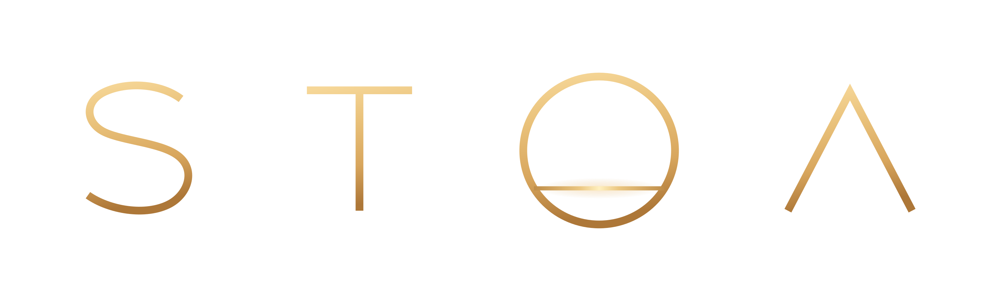

# Stoa

A calm, two-state UI suite for **WoW Forever** (interface 16001).

- **World state:** the Console is open along the bottom: black leather and brass, with chat, party, minimap and notes.
- **Combat state:** the console folds down flat and the **Halo** rises around your character: health and mana arcs, your spec's signature in the top slot, core buttons in a ring.

Layouts are built per **role** (Tank, Healer, Melee DPS, Ranged DPS), with a small **spec signature** on top. Changing spec swaps the layout automatically.

## What Stoa is not

Stoa does a lot, so it helps to say what it leaves alone. These are decisions, not gaps.

- **Not a damage meter.** Blizzard's meters are restyled, never replaced.
- **Not a boss mod.** No timers for encounters, no warnings read from the combat log. Stoa shows what the game shows you.
- **Not a top bar.** At a glance holds a few chosen numbers beside the chat; there is no row of modules along the top of the screen.
- **Not an auction or trade tool.** Prices, scans and crafting queues belong to addons made for them.
- **Not an icon wall.** Buffs, procs and cooldowns are words, coins and the game's own art, never a grid of timers.
- **Not a replacement for Edit Mode or the game menu.** The menu and the settings panel keep their own look, and Blizzard's own frames keep their jobs.
- **Not green against red.** Every state carries a word or a shape as well as a colour.
- **Not loud.** Nothing flashes, bounces or plays a sound of its own; procs use the game's own art and sound, and that can be turned off. If a feature cannot be quiet, it is left out.

## Status

What works today:

| Area | What it does |
| --- | --- |
| Core | Event bus, modules, saved settings (account and per character) |
| Tokens | Bone, Tide and Graphite themes, one per class, and Your class (follows the character); spacing and type scale. Every state carries a word or shape; the themes avoid red against green but are made for looks, so for colour that also holds up for colour-blind eyes use Colour vision |
| Colour vision | A setting on top of any theme (also on the welcome page and `/stoa vision`): Standard, Red-green (protan, deutan), Blue-yellow (tritan) or No colour (lightness only). It swaps only the state colours (warnings, accent, mana, dispel types, shields, health) and shows names in the text colour instead of class colours. Each set is checked by `Tools/art/cvd_audit.py`: simulated colour blindness (Machado 2009), CIEDE2000 colour difference between states that meet on screen, and WCAG contrast on every theme's panel. Red-green and Blue-yellow keep every pair clearly apart on all themes; No colour keeps them apart as far as lightness alone allows |
| Roles | Maps each dual-spec slot to a role; set it in settings or use the class default |
| State | World and combat states. After a fight the console opens again once things have been calm for 1, 3 (default), 5 or 8 seconds; in a group it also waits while anyone near you is still fighting (up to 20 seconds), so a chain of pulls stays one fight. In combat (Settings: In combat) the console folds while the Halo rises (default), stays open with the Halo, or stays open with no Halo; it only folds when the Halo is on, with or without the slide |
| Movers | `/stoa unlock` (or Move frames in settings) to drag the Halo, target plaque, cast bar, combat bar, party, raid, tank watch, click grid and damage meters. A small bar offers Lock, Reset this layout and a grid; arrow keys nudge the chosen frame 1 (Shift 10); right-click puts one back. Spots are saved per role, so healer and damage layouts differ; older saves still apply |
| Moving windows | Hold Shift and drag a quest, gossip, merchant, bag, character, spellbook, mail, auction or similar window by its title or edge. Each keeps its spot whenever it opens again; Shift and right-click puts one back. Shift-clicking items still splits and links as usual |
| Social | Accept invites from friends and guild; decline duels, party and guild invites from strangers |
| Auto-invite | Friends and guildmates who whisper `inv` (in game or over Battle.net) get invited; optionally the keyword works in guild chat. Says so when the group is full or you aren't leader |
| At a glance | Up to eight numbers you choose, to the right of chat on the console (out of combat): stats (attack or spell power, healing, crit, hit, regen, armor, defense and more), gear wear, bag room, gold, professions, zone, watched reputation, time, latency and framerate, plus anything another addon publishes through LibDataBroker (the feeds Titan Panel shows). It follows where you are: one set out in the world (gold, gold an hour, loot, professions, reputation, gear, bags), one in a dungeon and one in a raid (your role's stats first), named in the accent beside its heading. Hover a line to see where the number comes from (stats by school, regen while casting and outside the five-second rule, your most worn items, bag by bag, gold and reputation this session), click it to open the window you'd go to next (character sheet, bags, currencies, professions, reputation, map, clock). Gear, reputation and professions carry a slim bar, bags a column per bag and gold an hour a small line chart. Right-click or `/stoa glance` to choose, per situation; a pinned line shows in every situation. Saved per character and spec, and until you choose it follows your role |
| Company | `/stoa friends` or a click on the console's Company page: online friends, Battle.net friends in this game, and guild, with level, zone and AWAY/BUSY. Click to whisper, Shift- or right-click to invite. The console names a few friends online when you're alone |
| Console | Out of combat, on a tooled leather panel whose lines take your theme accent: portrait medallion (click to target yourself) with health and mana either side, and a Ready, Journey and Company page. Ready draws your most worn piece of gear as ten cells and your bags as one small column each, with the free count beside them; Journey draws experience with your rest in blue behind it and an accent mark where an hour at your pace would take you. Holds chat on its left page, with leather tabs standing on its top edge, and keeps bags and the game menu in its bottom-right corner. Strips the action bar art. Folds down flat in combat |
| Halo | In combat: health and mana arcs, signature spell with cooldown, target and cast bar around your character |
| Procs | The game's own proc art either side of the Halo and its proc glow on the combat bar button, from the game's proc events and from Stoa's own reading (usable, free or faster casts) while buffs are hidden; `/stoa procs test` |
| Game auras | Forever's aura container draws chosen buffs and debuffs with real timers even in combat; `/stoa auras` checks it |
| Reminders | Missing self-buffs as words: aura, seal and Righteous Fury for paladins, Inner Fire and Shadowform for priests. Under the Halo in combat, beside your role on the console out of it |
| Tank watch | For healers, a gold-lined leather plaque with a portrait coin at the Halo's upper left in combat: your focus or the group's tank, with a health word, shields and your buffs on them. Your click-casting bindings work on it |
| Target | A plaque like the tank watch, opposite it at the Halo's upper right, with portrait coin, level and kind, and an engraved bar; elite gets a doubled gold line and rare a silver one, each with the word. For any target, in or out of combat (a dead one dims and says DEAD): name, health, a HOSTILE cue, threat in words and auras. Right click for the unit menu |
| Party cards | Name and health percent, a thick health bar with shields on its end, and word pips for your buffs, Weakened Soul, dispels and low health. Rounded cards. A row under the Halo when you heal, with a grid of your click bindings on the left; a column on the left otherwise |
| Raid frames | When you heal, your group reads as a row under the combat bar at every size: ten players are two rows of party cards, twenty are compact rows of small cells with health filling the cell behind the name and one word (MAG, DIS, LOW, DEAD) in place of the percent; forty are two blocks of smaller cells side by side, groups 1-4 and 5-8. Otherwise one column per group on the left. `/stoa test raid`, `raid10` and `raid40` preview them |
| Click-casting | Fifteen bindings per role on party and raid cards: five mouse buttons, plain, Shift and Ctrl. `/stoa clicks` to edit. When you heal, a grid beside the cards spells out each click; by default it folds to its title and opens while you hover a card or hold Shift. Click its title to keep it open, or set it in settings or with `/stoa grid` |
| Action bars | Rounded-square icons with a hairline edge like the party cards, dim sockets for empty slots, Stoa type on keys and counts. Out of combat every console row shows (optionally only the main bar, with the rest on mouseover); in combat the bars step aside for the combat bar (your keys still work), or every row shows if the combat bar is off |
| Combat bar | In combat, a compact row of your main bar's spells under the Halo: rounded icons, keys underneath, cooldown sweeps; dimmed when unusable, blue when short of mana, faded with its key in the warning colour when out of range. Up to two more rows follow from the bottom-left and bottom-right bars, each a step smaller (Settings: Combat rows; healers default to one). Spells on a long cooldown sit dim until they're ready |
| Coin art | Each Halo coin carries its spell's icon faintly behind the letter, in colour while it runs or is ready and grey while it's off or coming back (a setting) |
| Shadow | For Shadow Priests: coins on the Halo's right for Shadow Word: Pain (P), Devouring Plague (D) and Vampiric Embrace (V) on your target, draining as they run and in the warning colour when off. Timing is kept per target, so switching between mobs keeps each one's Pain. An outline on the combat bar's next press; Mind Flay's three ticks on the cast line; SHADOWFORM over the ring when you're out of form; a PAIN n/m count of nameplates carrying your Pain; Shadow Weaving stacks on the target plaque. `/stoa probe` in a fight reports what the game hides from addons |
| Discipline | For Disc Priests: coins on the Halo's right for Penance (P), Inner Focus (I) and Power Infusion (PI), pale gold when ready and draining while they come back, bone while Inner Focus waits on your next spell; SHIELDS and RENEW counts of the group members carrying yours; an outline on Greater Heal while Inner Focus is up. The signature slot watches Penance |
| Paladin | For Retribution: coins on the Halo's right for your seal (S) and, once you've judged Crusader, Wisdom, Light or Justice, that Judgement mark on the target (J, forty seconds, kept fresh by Holy Strike with Sacred Arbiter). For Protection: Seal of Fury (S, amber while another seal runs), Holy Shield (H) and Consecration on the ground (C). An outline on the combat bar's next press for both. As a tank in a group, TAUNT over the ring when your target is fighting someone else (Judgement with Seal of Fury taunts). With Twist of Light, the moment a main-hand swing lands the other seal of the pair (Command and Righteousness) is outlined and named under the coins, so the next swing carries both. The signature slot watches Holy Strike, or Templar's Bulwark for tanks |
| Druid | Follows your form first, then your role. Balance: Moonfire (M) and Insect Swarm (I) coins, LUNAR or SOLAR while an Eclipse is up, and the next press as two Starfires to one Wrath unless the Eclipse says otherwise. Cat: Rip (R), Rake (K) and Faerie Fire (F) coins and your combo points; Shred outlined on Clearcasting, Shifting Power when energy runs low. Bear: Lacerate (L, with its stacks), Demoralizing Roar (D) and Faerie Fire coins, TAUNT with Growl outlined. Restoration: Swiftmend (S), Wild Growth (W) and Nature's Swiftness (N) coins, REJUV and REGROWTH counts on the group, and REJUV, REGROWTH and GROWTH on party cards. Out of the form your role wants in a fight, its name shows over the ring. Timers use classic lengths until Forever's are known; the game's own times win wherever it shows them |
| Mage | Your tree is read from the talents you know. Arcane: Arcane Power (AP), Presence of Mind (PM) and Evocation (E) coins, your Arcane Blast stacks, MISSILES while Missile Barrage is up. Fire: Fire Blast (FB), Combustion (C) and, with Improved Scorch, Fire Vulnerability (S) coins; HOT STREAK n/3 with Pyroblast outlined at three. Frost: Frost Nova (N), Ice Barrier (B) and Ice Block (IB) coins; FINGERS while Fingers of Frost is up, Ice Lance outlined then and right after each Frostbolt. NO ARMOR and NO INTELLECT reminders |
| Other classes | Warriors, Rogues, Hunters, Warlocks and Shamans get their main cooldown in the Halo's slot and the game's own suggested next press outlined on the combat bar. The Halo's power arc follows your power: mana, pale gold energy or bone rage |
| Blizzard windows | Quest, gossip, merchant, trainer, bags and tooltips on dark rounded panels, with light quest text in Stoa's type, dark rounded buttons, a quiet close cross and plain-word tabs |
| Dungeon kit | Journey shows experience an hour and time to level beside a small line chart of your pace (worked out over the last half hour, started again at each level, hidden at the highest level) and, when you are alone, the progress of the nearest watched quest. `/stoa pull` is a countdown: the game's own when you can use it, otherwise 3, 2, 1 in group chat and a large number on screen. A ready check dresses the prompt in a Stoa panel and puts READY, NOT READY or WAITING on each party card. The target plaque says KICK while the target casts something you can interrupt. Each has its own setting |
| Minimap | A square with rounded corners like Stoa's windows (or round, in settings), framed by an accent line and a hairline, or by a painted leather and brass frame (Ornament: Painted, which also frames the portrait coins and the Halo's signature slot); serif zone name, wheel to zoom |
| Icon tray | Other addons' minimap buttons (LibDBIcon ones and any icon-sized button on the map that isn't Blizzard's or a map pin) gather into one small button below the map's left corner. Click it for a tray of their icons in sockets that follow the map's shape (round on a round map, rounded squares on a square one); it folds a moment after the mouse leaves. A setting turns it off; MinimapButtonButton and similar addons count as the same job |
| Top of screen | Buffs as cropped icons in a hairline square with the time under them (pale gold when it runs short, amber edge for debuffs). Quest tracker headers in the display face over a hairline, bone quest titles, quiet minus and plus to fold. The zone above the minimap on a dark rounded panel with the clock beside it; tracking, calendar and the addon button wait for the mouse |
| Nameplates | Blizzard's plates in a rounded dark track: amber for every enemy, pale gold for neutral, blue for friends, grey only for tapped or dead; enemy players in class colour. A bone edge on your target, the level as a plain number shaded by difficulty, cast bars on the same rounded ground. Styles: Stoa, Bold (heavy frame, health value), Inline (name and health in the bar), Brass (brass edge, level badge), Slim. Target marked by edge, arrows or glow; other plates can fade, the target can grow |
| Swing timer | Blizzard's swing timer (place it in Edit Mode) as a flat bar in the nameplates' rounded dark track: pale gold for the main hand, blue for the off hand, bone for ranged; amber words when out of range |
| Tooltips | Cards with a header band behind the name (room above and below it, a soft shadow under it), names in the serif and in the unit's colour (class, or the nameplates' reaction colours). The edge stays a plain hairline except for rank: elites get a doubled gold line, rares a doubled silver one, rare elites gold outside and silver inside, bosses a heavier doubled gold, and their header warms with that colour fading across it; items above common fade their quality colour across the header. For enemies, how hard they are as a word (TRIVIAL, EASY, EVEN, HARD, DEADLY, plus ELITE, RARE or BOSS) rather than the game's red-green level colours; whom they target (YOU in the warning colour), what they cast and your threat. Players show their guild and, out of combat, item level. Gear says how it compares with what you wear in that slot ("+6 over your chest"); any item shows how many you own in bags and bank. In combat a card keeps only name, difficulty, target, casting and threat. Above the console or at the cursor (`/stoa tooltip`), and unit cards can hide in combat until you hold Shift |
| Windows | Restyled windows and Stoa's own pages share one build: 10px corners, a lighter header band down to where Blizzard's content starts (warm for trade windows, cool for social ones, plain for the rest) with the title seated in it and a soft shadow under it, a dark footer tray along the bottom, darker wells behind grouped things (quest rewards, text boxes), and tabs left where Blizzard hangs them, dressed as dark tabs tucked under the window with the chosen one underlined. Corner art is cut by `Tools/art/window_corners.py` |
| Window stone | Tyler's stone art (faint rings and grain, `Tools/art/source/wizard-stone2.png`) in the body of every restyled window and Stoa's own pages, tinted with the theme's text colour so it sits on any theme, and fading out towards the top where titles and text start; the console keeps its leather. A setting turns it off. The texture is cut by `Tools/art/window_stone.py` |
| More windows | Spellbook, talents, world map border (never the map itself), mail, auction house, group finder, and friends and guild in the same dark panels (the game menu and settings panel are left alone, to avoid blocked-action errors), dressed when each loads |
| Bags | Rounded item slots with a hairline edge; quality shown as an edge colour plus a corner mark for epic and above, item level on gear, free-slot count, money in g/s/c letters, a Sort button, and a combined or separate layout option |
| Character sheet | A Stoa panel, quality edges and item level on every equipment slot, WORN (under 30%) and BROKEN words for durability, an average item level line, and item levels in the inspect window |
| Damage meters | Blizzard's meter windows with no panel, just outlined words and faint bars (your own in the accent, names in class colour), side by side in the top-left corner |
| Comforts | Each its own setting, and Shift stops any of it: faster auto loot, a further camera, skip one-option gossip (on by default); accept quests, hand in quests (a choice of reward always waits for you), skip cinematics, quiet red errors in combat (off by default); hide other people's duel results and drunken lines (on); decline duels, release in battlegrounds, accept resurrections (off) |
| Merchants | Sells grey junk and anything you've marked as junk, and repairs, from guild funds when allowed |
| Welcome | Once per character, a short wizard in one window, with a step rail to go back: start by hand, from another character's saved setup or as Stoa ships; what each spec plays; theme (house and every class), ornament and colour vision; what a fight does (fold the console with the Halo, keep it open with the Halo, or no Halo, with the calm seconds and group wait under folding); how much (Full, Quiet, Classic feel); the other addons Stoa found (only when there are some: who does each job and Stoa's look for Bagnon, Details, Questie); then a summary with ways to try it. Choices that need a reload wait for Finish, which reloads once. Other addons questions wait for it on a first login |
| Launch check | On the first login with a new game build, checks every spell ID, game function, Blizzard frame and event Stoa relies on, and says in one line if a feature is off because something moved. `/stoa check` (and `/stoa report`) list the details |
| Cooldown Manager | Off for now (Settings > Cooldowns). Halo coins ask the game's Cooldown Manager whether a spell is ready or a buff is up, which it knows in combat; its rows keep running out of sight. Spells it doesn't track keep Stoa's own reading. `/stoa cdm` |
| Error guard | Stoa records its own errors once each with a count. If one part keeps erroring (a loop), it is switched off until the next reload and Stoa says so in chat, so an error can't lock up the screen. `/stoa report` shows your setup and the errors, ready to copy |
| Other addons | Spots a known bag, nameplate, chat, tooltip, bar, minimap, group frame, click-casting or damage meter addon (Details, Skada, Recount) and asks once which should do that job; Stoa's part waits meanwhile. A whole UI such as ElvUI or SpartanUI doesn't work beside Stoa, and Stoa asks you to turn one off |
| Leatrix Plus | Works beside Leatrix Plus the same way: where both do a job (faster looting, junk, repairs, quests, gossip, camera, invites, duels, releasing in battlegrounds, accepting resurrections, a square minimap), Leatrix Plus's switch wins while it is on |
| Stoa's look for other addons | Questie's quest tracker, Bagnon's bag windows and Details' meters can wear Stoa's look: offered once (after any "two addons, one job" question), and the addon keeps working exactly as before. Questie gets Stoa's type, Bagnon a Stoa skin (also in Bagnon's own skin list), Details a Stoa skin with no panel, faint bars and Stoa's type. Leave it puts their own settings back; `/stoa looks` asks again. Stoa's fonts and a flat bar are in LibSharedMedia as Stoa Display, Stoa UI and Stoa Flat for any addon with a font list |
| OneForAll | Works beside OneForAll. Where both do the same small job (fast loot, selling junk, repairs, the loot feed, accepting and handing in quests, camera zoom, moving windows, the chat copy button, a tooltip's target line, upgrade marks, invites and duels), OneForAll's switch wins while it is on and Stoa's waits; turn it off there and Stoa's comes back. Stoa keeps the minimap (OneForAll's square is left to Stoa's), the chat rail (OneForAll's chat-hide button joins Stoa's column) and waits for OneForAll's welcome page before showing its own. At a glance gains Library Books (found and to find, opens its books panel) and Dungeon guide (opens its dungeon guide). `/stoa addons` lists what is shared |
| Saved setups | Each character's setup (frame spots, At a glance, combat rows and other per-spec settings, roles and click-casting) is saved account-wide when it logs out. On another character, Load a setup on the backup page, Use a saved setup on the welcome page or `/stoa setups`; a different class takes the layout and settings but keeps its own roles and click-casting |
| DoesItDie | With the DoesItDie addon installed, the target plaque shows what your DoTs will still take off as a bone stretch at the end of its health bar, and a skull slides over the portrait once they'll finish it. DoesItDie does the tracking (through its public API); Stoa draws it. It counts as a companion: the welcome page's other addons step and `/stoa addons` list it. Each part has a setting |
| Pawn | With Pawn installed, Stoa's upgrade marks give Pawn's answer (its stat scales for your spec) instead of Stoa's own weights, so the two never disagree. Where Pawn draws its own marks (its tooltip lines, its bag arrows, its quest reward pick; each a switch in Pawn), Stoa leaves that place to Pawn |
| Backup | All of Stoa's settings as one line of text to keep safe, and a place to paste one back to restore it |
| Shared core | Shared helpers every feature leans on: the spellbook read once (best rank of each spell, costs), item worth (level, sell price, against what you wear, junk), your group as a list, mana and the five-second rule, one set of show rules (always, in or out of combat, in a group or raid, alone, with a target, on mouseover, never), settings kept per spec, and unit events asked of the game for just the units that matter |
| Per spec | Combat rows, the click grid, the bar tray and At a glance keep their own setting in each spec, so a healing spec and a damage spec each look right without changing anything |
| Mana play | For every mana user: a small spark runs along the Halo's mana arc and the console's mana bar while the five-second rule holds back spirit regeneration, then pulses on each regeneration tick; while you cast, the mana the spell will take is shaded; druids in cat or bear form see their mana as a slim bar under the power number. Each has its own setting |
| Auto-uprank | When you learn a new spell rank, bar slots holding an older rank get the new one, out of combat and never with something on your cursor; macros are left alone. A quiet line says what changed. `/stoa uprank` runs it now |
| Quest reward | With a choice of rewards, the one that beats what you wear is marked UPGRADE (largest gain), otherwise the one that sells for most is marked VALUE, with a thin accent outline and a small word |
| Junk list | A Junk button on Stoa's bag turns on marking: click items to mark or unmark them (it turns off when the bag closes or a fight starts). Marked items show JUNK, sell with the greys, and say so on their tooltip. `/stoa junk add\|remove <item>`, `list`, `clear` |
| Loot feed | Your last few loots and money above the chat, out of combat by default, fading after about 8 seconds. Gold an hour and loot value this session are lines for At a glance. `/stoa loot`, `/stoa loot reset` |
| Threat meter | Up to five people by threat on your target, or your tank's, with the tank first and marked TANK, under the damage meters and in their style. In combat in a group by default. Non-tanks see PULLING AGGRO with the percent on the target plaque at 90% |
| Raid markers | For tanks and leaders in a group, eight markers and clear: click marks your target, Shift-click places a world marker. Movable |
| Group buffs | Out of combat, the console's Ready page says who in range is missing a buff you can cast (FORTITUDE · 3 missing; any blessing counts for paladins), and the same line shows during a ready check |
| Chat | Web addresses in chat are links that open a box to copy them; a quiet copy mark (or Shift-click a chat tab, or `/stoa copychat`) shows the last 200 lines to copy; the main chat's last 100 lines come back, dimmed, after a reload or login. A time column on each line, more air between lines, the chat buttons in one quiet column and a quiet typing strip |
| Map | The world map fades while you move, and a zone's level range shows under the map title and on the minimap's zone tooltip (classic zones; English names for now) |
| Gear scores | Gear is scored for your class and role by Stoa's own stat weights (Core/Weights.lua), which shift with your level (more Stamina and Spirit early, more hit and crit near 60): the tooltip says UPGRADE +12% over your chest, for Healer; bag slots holding an upgrade show a small UP; the quest reward mark uses the same score. Item level is the fallback when an item can't be scored |
| Quest items | A small row beside the Halo with a button for each item your quests ask you to use, filled from your quest log; counts and cooldowns keep up in combat, the row itself changes out of combat (secure buttons) |
| Emergency item | One button beside the Halo for your healthstone, else your best healing potion, else your best bandage. In combat it stays in view, quietly (Forever can hide your own health from addons in a fight); out of combat it shows, with LOW, when you're under 40% health |
| Timers | A slim bar near the top: flights show where you're going and the time left, from known flight times (Data/FlightTimes.lua) or timed the first time you fly a route and remembered; the flight map's tooltips show the time. Breath, fatigue and feign death use the same bar, worded, in place of Blizzard's. `/stoa timers` shows a sample |
| Trainer | A line under Journey on the console counting the spells and ranks your class trainer would teach you now (Data/TrainerSpells.lua), with their cost; later ranks only once you know the spell, other races' and factions' spells left out. A note when a new level brings some. `/stoa trainer`, a click on that line, or the Training button beside your class trainer's window opens Training: what's waiting now and what the next two training levels bring, each with its price and the totals. Prices are learned the first time you open a trainer of your class (it lists every spell it will teach) and kept for all your characters. Right-click a spell you'll never train to skip it on that character |
| Gathering | Herb and ore node tooltips show the skill they need against yours, with TOO LOW when you're short (English names for now) |
| Snapping | In unlock mode frames snap to the screen's edges and centre and to other frames within 8px, with a faint guide line; hold Shift to drop freely. A frame snapped to another is kept against it, so moving the Halo carries its plaques |
| Presets | Full is how Stoa starts. The welcome page offers the others and says what each changes against Full as you hover it: Quiet (fewer words: no tooltip details, quest line or At a glance, extra bar rows on mouseover) or Classic feel (Blizzard's own windows, bags, character sheet, tooltips, top of screen and nameplates, with Stoa's console, Halo and frames). `/stoa preset` |
| For other addons | `StoaAPI`: add lines to At a glance, hear Stoa's state, role and theme changes, and borrow its colours and fonts. See `Core/API.lua` |
| Settings | Options > AddOns > Stoa (the settings panel's own search box finds any Stoa setting) |

Fonts are the main gap: see below.

## Commands

| Command | Does |
| --- | --- |
| `/stoa` | Open settings |
| `/stoa unlock` | Toggle frame moving |
| `/stoa reset` | Put moved frames back in their default spots, in every role |
| `/stoa safe` | Turn off every skin that touches Blizzard frames (chat, bags and menu, bar art, buttons, windows, more windows, tooltips, bags, character sheet, top of screen, nameplates, swing timer, meters, map, chat, quest reward) and reload |
| `/stoa tooltip cursor` | Tooltips at the cursor; `/stoa tooltip console` puts them back above the console |
| `/stoa vision` | Cycle colour vision modes, or name one: `redgreen`, `blueyellow`, `nocolour` or `standard` |
| `/stoa windows reset` | Put every moved Blizzard window back in its usual place |
| `/stoa theme` | Cycle the themes (house, Your class, then each class) |
| `/stoa keywords inv, invite` | Set auto-invite keywords |
| `/stoa friends` | Open the Company roster |
| `/stoa glance` | List what At a glance can show; `/stoa glance add <name>`, `remove <name>`, `reset` (`/stoa tally` still works) |
| `/stoa welcome` | Open the welcome wizard again |
| `/stoa check` | Check the spell IDs, game functions and Blizzard frames Stoa relies on against this game build |
| `/stoa report` | Your version, game build, spec, theme and screen and UI scale, language, game settings Stoa holds, other addons and any errors Stoa caught, ready to copy |
| `/stoa cdm` | What the game's Cooldown Manager tracks and which of its values Stoa can read (try it in a fight) |
| `/stoa restore` | Put back every game setting Stoa changed (camera distance, map fade, target plate size, combined bags, proc art), unless you've changed it since |
| `/stoa addons` | List other addons doing one of Stoa's jobs and ask again which to keep |
| `/stoa backup` | Copy your settings as text, or paste a backup to restore it |
| `/stoa xp` | Experience this session, per hour, and time to level |
| `/stoa pull [seconds]` | Pull countdown for the group (10 by default); `/stoa pull 0` cancels |
| `/stoa uprank` | Put the best rank of each spell on your bars now |
| `/stoa junk add <item>` | Mark an item as junk (link or ID); `remove <item>`, `list`, `clear` |
| `/stoa loot` | Gold an hour and loot value this session; `/stoa loot reset` starts again |
| `/stoa trainer` | Open Training: spells waiting now and coming next, with prices (`/stoa trainer list` prints them in chat) |
| `/stoa tray` | List the addon icons in the tray; `leave <name>` keeps one on the minimap, `take <name>` brings it back |
| `/stoa copychat` | Copy the chosen chat window's last 200 lines |
| `/stoa preset full` | Start from a preset: `full`, `quiet` or `classic`, then /reload |
| `/stoa state` | Print the current state and role |
| `/stoa clicks` | Edit click-cast bindings for your current role |
| `/stoa grid` | Cycle the click grid: always open, folded until needed, or hidden; or name one: `open`, `fold`, `hidden` |
| `/stoa test` | Show sample party cards without a group; `/stoa test raid`, `raid10` or `raid40` for a raid |
| `/stoa probe` | In a fight, print what the game hides from addons right now |
| `/stoa combat` | Practice combat out of combat: the console folds, the Halo, combat bar and group frames take their combat places. Again to end it |

## Install

Copy this folder into the game's AddOns folder and name it exactly `Stoa`:

- Beta: `World of Warcraft\_classic_beta_\Interface\AddOns\Stoa`
- Live (from launch): check the Forever folder name in your install, e.g. `World of Warcraft\_forever_\Interface\AddOns\Stoa`

## Releases

Installers download the latest `Stoa-<version>.zip` from the repository's Releases page and unpack it into the AddOns folder; the zip already holds a single `Stoa` folder.

To cut a release:

1. Set `## Version:` in `Stoa.toc` (for example `0.9.1`).
2. Add a `## 0.9.1` section to `CHANGELOG.md`; it becomes the release notes.
3. Commit, then `git tag v0.9.1 && git push origin v0.9.1`.

The workflow in `.github/workflows/release.yml` fails if the tag and the TOC version differ or the changelog section is missing. To build the same zip without CI, run `Tools/package.sh`; it writes `dist/Stoa-<version>.zip`. `.pkgmeta` is ready for the BigWigs packager (CurseForge, Wago); how to switch that on is in `CHANGELOG.md`.

Before a build goes to the game, `python3 Tools/sim/run.py [CLASS]` (needs `pip install lupa`) loads every file in `Stoa.toc` under a rough mock of the game's API, fires the login events and a round of combat events with secret values, and runs every `/stoa` command. It prints any errors, and it fails on any game function Stoa calls that Blizzard's own UI source for Forever doesn't have (`Tools/sim/api.txt`, regenerated by `Tools/sim/apilist.py`; `--lenient` only reports). Names Stoa only tests for before using are listed as absent, not failed. A clean run doesn't prove a feature works in game; it catches typos, nil calls, maths on secret values and calls to functions this client lacks.

## Forever notes

If a game patch raises the interface number before Stoa catches up, the AddOns list shows it as out of date: tick "Load out of date AddOns" there and it loads as before.

Forever runs the modern client, so Stoa follows Midnight-era rules: unit values can be secret in combat, and the combat log is closed to addons. Stoa never does maths on a value without checking `issecretvalue` first (see `Core/Util.lua`), and it skins Blizzard's own data rather than recalculating it. When the game says auras are hidden (`C_Secrets.ShouldAurasBeSecret`), buff reminders and aura lists stand down rather than reading an empty list as "missing".

## Fonts

Stoa ships with Tenor Sans for names and numbers and Inter SemiBold (18pt cut) for labels, in `Media/Fonts`. Both are under the SIL Open Font License; see `Media/Fonts/OFL.txt`. If a font file is missing, Stoa falls back to Cormorant Garamond if present, then the game's own fonts.

A font file that is new to the game is only picked up after a full restart of the game, not a `/reload`.
